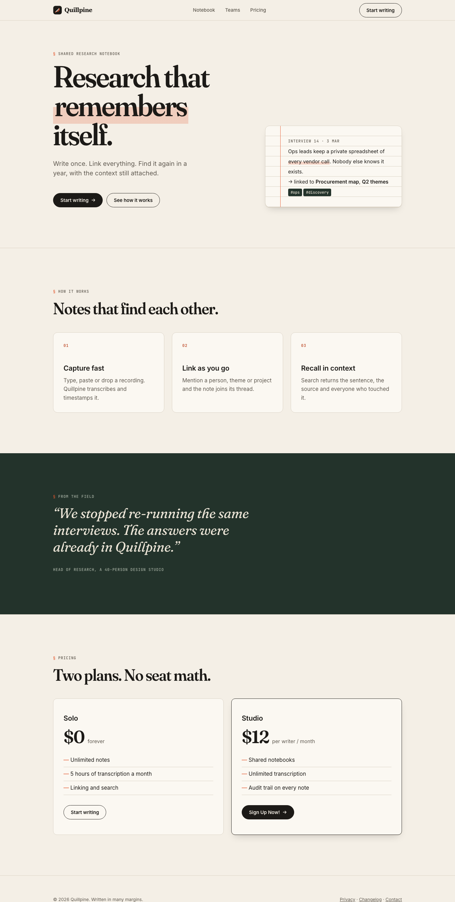
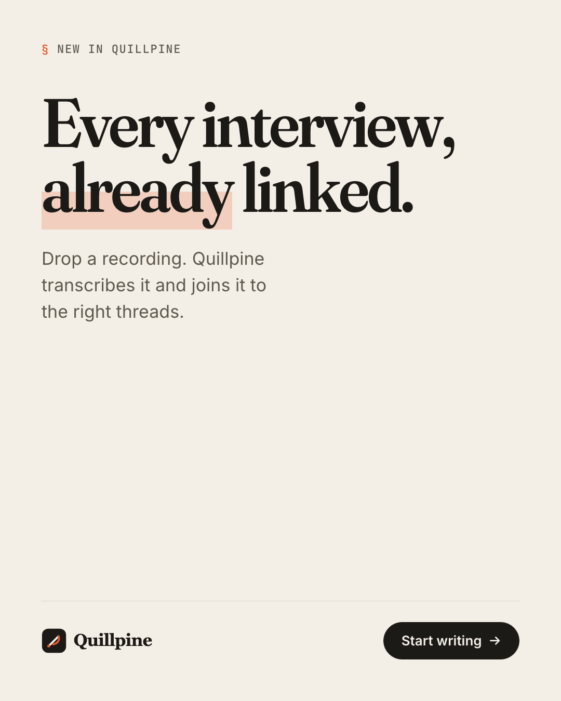
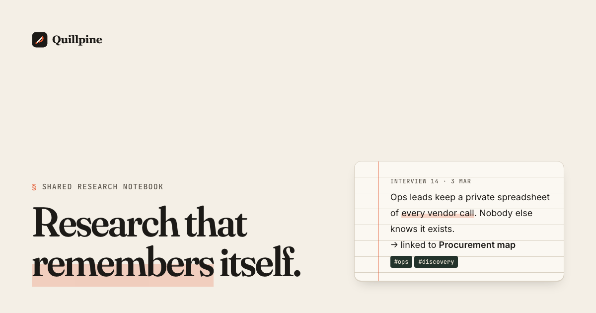

# easy-brand

An agent skill that reverse-engineers the **existing** visual identity of a website or app into a reusable, evidence-based brand system: design tokens, guidelines, voice, marketing template specs, and a generated `brand-identity` skill that future agents can load to produce on-brand work.

It does not redesign anything. It documents what already exists, tags every rule **Observed / Inferred / Recommended**, cites sources, and writes only to a new `brand/` directory.

## Install

```bash
npx skills add rufatalv/easy-brand
```

Works with any agent supported by [`skills`](https://github.com/vercel-labs/skills) (Claude Code, Cursor, Codex, etc.).

## Use

Open your project in your agent and ask:

> Extract our brand identity into a brand system.

or

> Use brand-extractor on this repo.

## Example

See a full run on a sample product site in **[examples/quillpine](examples/quillpine/)**, or browse it live at **https://rufatalv.github.io/easy-brand/**.

| Source site | Generated templates |
|---|---|
|  |   |

## What you get

```text
brand/
├── README.md, BRAND_GUIDELINES.md, BRAND_AUDIT.md, BRAND_VOICE.md
├── tokens/        colors.json/.css, typography, spacing, radii, shadows, motion, layout
├── references/    visual DNA, typography, colors, composition, imagery, graphics,
│                  components, motion, 3D (if present), voice, consistency model
├── templates/     template metadata + a few HTML/SVG examples
├── assets/        copies of existing logos/icons (never invented)
└── skills/brand-identity/   a skill future agents load to stay on-brand
```

Only files with real content are created. Missing information is marked **Not established**.

## How it works

| Phase | |
|---|---|
| 1. Discover | Framework, styling stack, tokens, fonts, assets, animation and 3D libraries |
| 2. Observe | Renders the app at 390 / 768 / 1280 / 1440 px when a browser tool is available |
| 3. Extract | Typography, color, spacing/layout, shape, components, imagery, 3D, motion, voice |
| 4. Classify | Observed / Inferred / Recommended, with sources and documented conflicts |
| 5. Formalize | Token JSON in one shared schema, plus guidelines |
| 6. Extend | Consistency rubric, per-platform marketing specs, template metadata |
| 7. Generate skill | `brand/skills/brand-identity/SKILL.md` + self-contained references |
| 8. Validate | Bundled validator: JSON/CSS/SVG/link/frontmatter checks and WCAG contrast |
| 9. Report | Identity summary, files, gaps, inconsistencies, next steps |

### Bundled validator

Stdlib Python, no install:

```bash
python3 skills/brand-extractor/scripts/validate_brand.py validate brand/
python3 skills/brand-extractor/scripts/validate_brand.py contrast "#0A84FF" "#FFFFFF"
python3 skills/brand-extractor/scripts/validate_brand.py matrix brand/tokens/colors.json
```

## License

MIT
