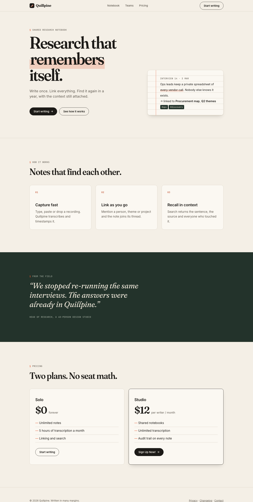
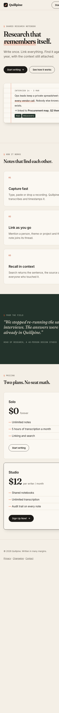
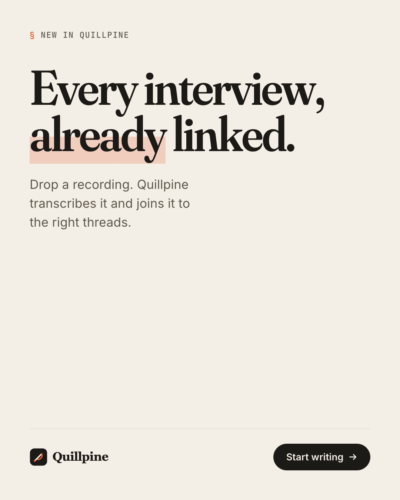
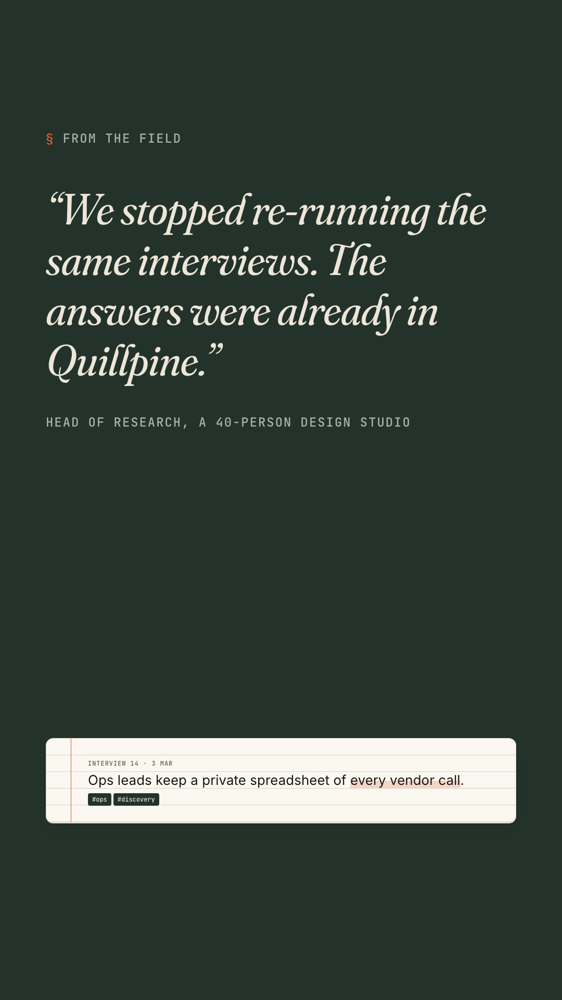
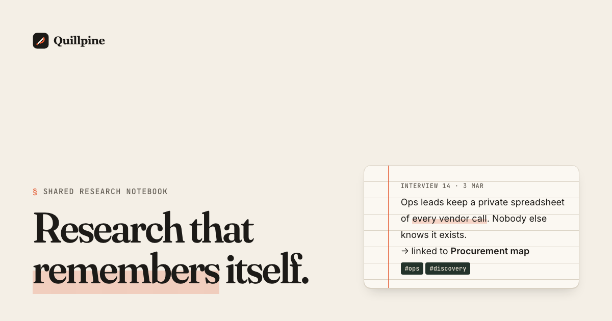
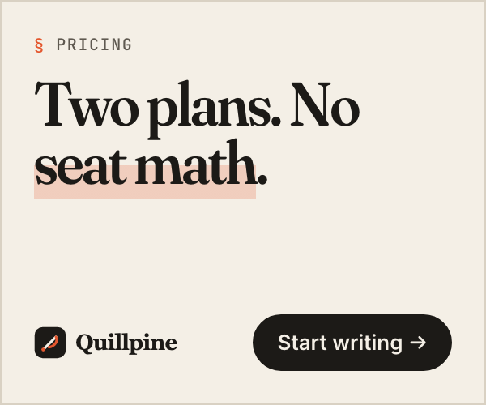

# Example: Quillpine

An end-to-end run of **brand-extractor** on a small product site.

> Quillpine is a **fictional** product made up for this example. Any resemblance to a real company is unintended.

| Input | Output |
|---|---|
| [`site/`](site/): static HTML/CSS marketing page | [`brand/`](brand/): tokens, guidelines, audit, voice, templates, logo, generated agent skill |

**Live:** [site](https://rufatalv.github.io/easy-brand/examples/quillpine/site/) · [all examples](https://rufatalv.github.io/easy-brand/)

## 1. The source site

 

## 2. What the skill extracted

**Visual impression** (from [brand/references/visual-dna.md](brand/references/visual-dna.md)):

> Warm paper surfaces and warm ink text carry a heavy, tightly set Fraunces display. Uppercase mono labels are marked with a §. A ruled-paper card with an orange margin line stands in for imagery. One forest-green band per page adds depth. The signal orange is used only as small marks.

**Eight principles:**
1. Paper, not screen
2. Notebook motif
3. Signal in small doses
4. Three voices of type
5. Tight, heavy display
6. One dark band
7. Hairlines over shadows
8. Calm motion

**Tokens** (every one cites its source line):

```json
"qp-signal": {
  "$value": "#E4572E", "$type": "color",
  "$description": "Brand accent. Signal orange used in small doses.",
  "status": "observed", "source": ["site/styles/tokens.css:9 --qp-signal", "site/assets/logo.svg"],
  "role": "accent", "tier": "core",
  "contrast": { "on": "qp-paper", "ratio": 3.22, "level": "AA large/UI only" }
}
```

**Problems it found** (from [BRAND_AUDIT.md](brand/BRAND_AUDIT.md)). The site was left unchanged.

| Found | Where |
|---|---|
| CSS says the note card is rotated -1.5°, but the rendered card isn't (the reveal's `transform: none` overrides it) | `.note-card` vs `.reveal.is-visible` |
| Pricing plans use a 12px radius; every other panel uses 14px | `.plan` |
| Footer hover hard-codes `#E5582F`, a near-duplicate of the accent that fails AA (3.18:1) | `.footer a:hover` |
| "Sign Up Now!" breaks the "Start writing" CTA voice | Studio plan |

**Marked as gaps, not invented:**
- photography;
- a reversed logo;
- dark mode;
- forms and modals;
- error-message voice;
- a positioning statement.

## 3. Templates built only from extracted tokens

| Instagram feed 1080×1350 | Instagram Story 1080×1920 |
|---|---|
|  |  |

| Open Graph 1200×630 | Ad 300×250 |
|---|---|
|  |  |

Sources: [brand/templates/](brand/templates/) · metadata: [templates.json](brand/templates/templates.json)

## 4. The generated agent skill

[`brand/skills/brand-identity/SKILL.md`](brand/skills/brand-identity/SKILL.md) is a self-contained skill (`quillpine-brand-identity`). Once installed, an agent asked to "make a LinkedIn post about our new search" will:
- use Fraunces, Inter and JetBrains Mono in their roles;
- keep orange to marks only;
- add a § eyebrow and a ruled note;
- write a headline of 7 words or fewer ending in a period;
- use "Start writing →" as the CTA;
- validate the result against the consistency rubric.

## Files

```text
brand/
├── README.md  BRAND_GUIDELINES.md  BRAND_AUDIT.md  BRAND_VOICE.md
├── tokens/        colors.json colors.css typography.json spacing.json radii.json shadows.json motion.json layout.json
├── references/    visual-dna  typography  colors  composition  graphics  components  imagery  motion  content-voice  consistency-model
├── templates/     README.md templates.json template-base.css  social/ web/ advertising/
├── assets/logos/  quillpine-logo.svg
└── skills/brand-identity/  SKILL.md + 7 references
```

`3d-language.md`, icons and presentation templates were left out on purpose because the source has none of them. [brand/README.md](brand/README.md) explains each omission.
